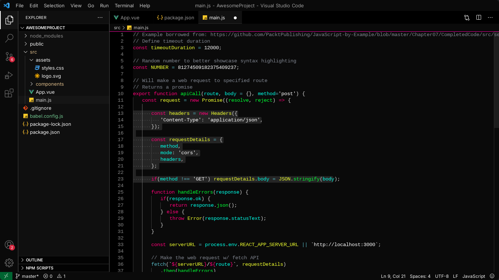

# Halide

A dark theme for Visual Studio Code.

## Preview

## Color Palette

| Color | Hex |
|:---|:---|
| Background | `#0A0A0A` |
| Foreground | `#D4D4D4` |
| White | `#FFFFFF` |
| Cyan | `#00FFE7` |
| Lime | `#EFFF2F` |
| Pink | `#FF0078` |
| Green | `#00FF34` |
| Teal | `#56B6C2` |
| Red | `#F51535` |

## Installation

1. Open Extensions in VS Code (`Ctrl + Shift + X`).
2. Search for **Halide**.
3. Click **Install**.
4. Open the Command Palette (`Ctrl + Shift + P`).
5. Select **Preferences: Color Theme**.
6. Choose **Halide Dark**.

## Credits

Created by [Taleex](https://github.com/taleex).