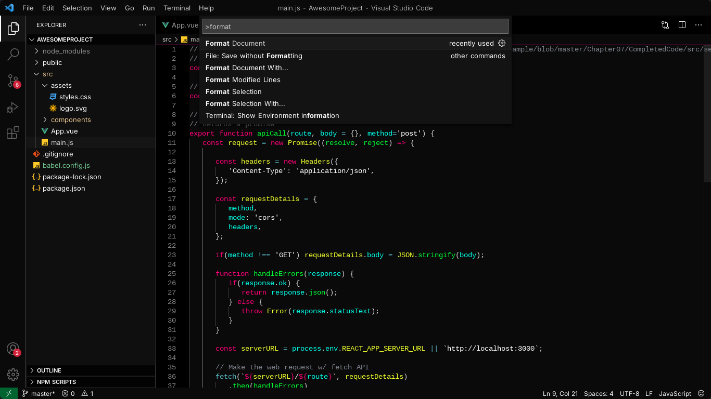
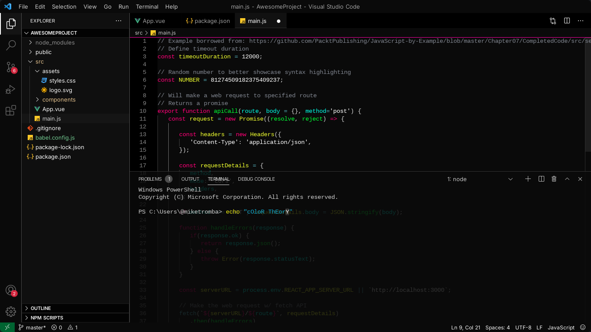

# taleex

A dark theme based on Taleex's personal preference: he likes dark themes when they are done well.

## Preview

### Default Editor

### Command Palette

### Integrated Terminal

## Color palette

- Background: `#0A0A0A`
- Foreground: `#D4D4D4`
- White: `#FFFFFF`
- Cyan: `#00FFE7`
- Lime: `#EFFF2F`
- Pink: `#FF0078`
- Green: `#00FF34`
- Teal: `#56B6C2`
- Link red: `#F51535` (hover: `#FF334F`)

## Creator's note

Taleex plans to create a light mode and a surprise mode in the future.

## Credits

Created by [Taleex](https://github.com/taleex).

## Rights

Copyright © Taleex. All rights reserved.
